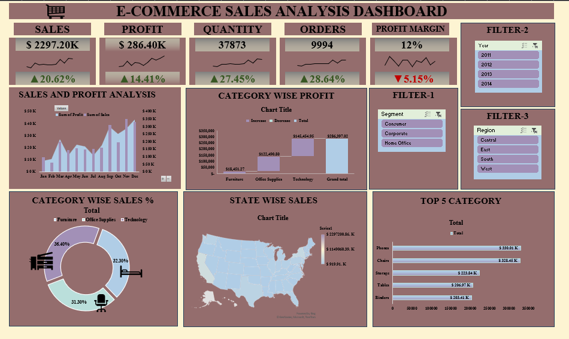
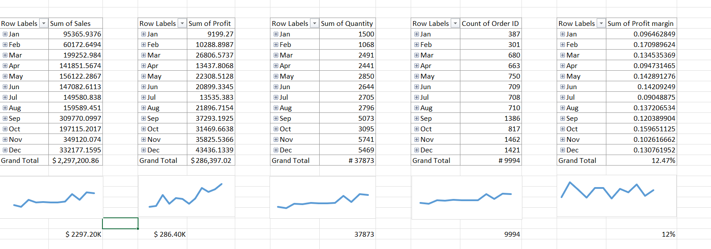
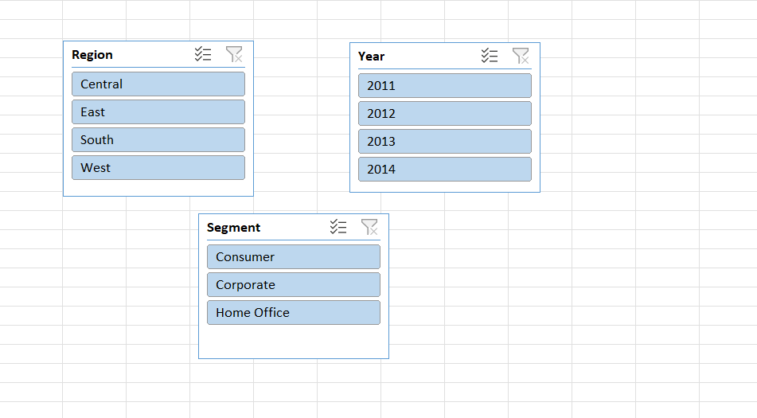
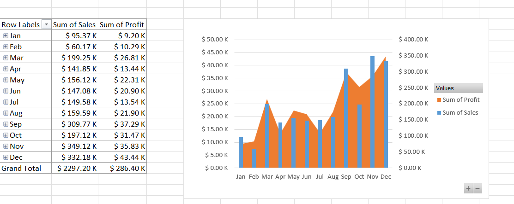
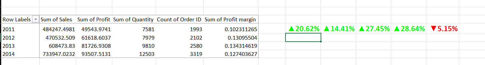
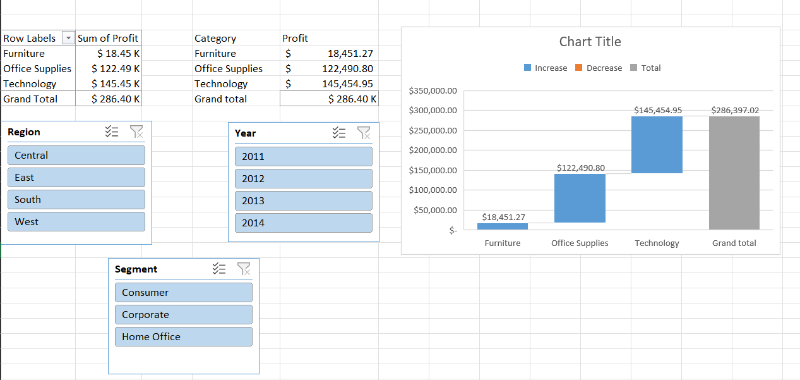
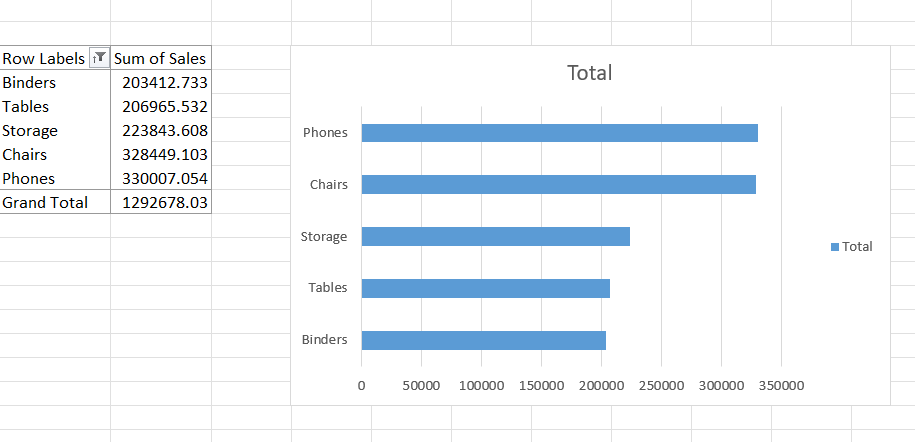
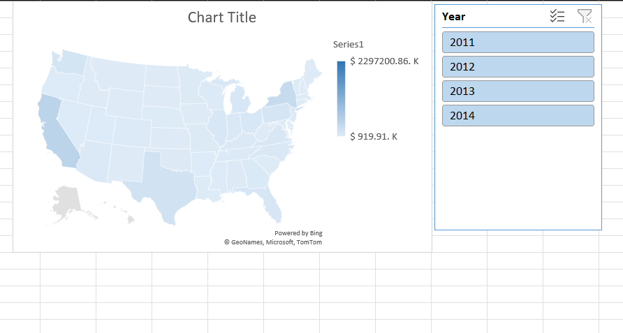

# E-Commerce Sales Analysis Dashboard

An interactive Excel dashboard that analyzes four years (2011-2014) of e-commerce sales. It shows how much was sold, how much profit was made, which categories and states perform best, and how the business grew year over year. Slicers let you filter the whole dashboard by **Year**, **Segment** and **Region** with one click.

## Project Overview

The goal of this project is to turn raw sales data (9,994 order lines) into a clear, easy-to-read report. The dashboard answers questions like:

- How much did we sell and earn in total, and how fast is the business growing?
- Which months are the strongest for sales and profit?
- Which product categories make money, and which ones lose it?
- Which products and states sell the most?
- How do results change by customer segment and region?

## Dashboard Preview

Full dashboard with all four years selected and no other filters applied:

## Key Numbers (2011-2014)

| Metric | Value |
|---|---|
| Total sales | $2,297,201 |
| Total profit | $286,397 |
| Quantity sold | 37,873 units |
| Orders (order lines) | 9,994 |
| Profit margin | 12.47% |

## Dashboard Screenshots

### 1. KPI Cards

Five cards show Sales, Profit, Quantity, Orders and Profit Margin. Each card has a small trend line and a growth figure compared with the previous year.

### 2. Filters (Slicers)

Three slicers control every chart and number on the dashboard: **Year**, **Segment** (Consumer, Corporate, Home Office) and **Region** (Central, East, South, West).

### 3. Sales and Profit Analysis by Month

Bars show profit and the area shows sales for each month (all years combined).

- November is the highest sales month ($349K), followed by December ($332K) and September ($310K).
- December has the highest profit ($43.4K).
- February is the weakest month for sales ($60K).
- Sales and profit rise sharply in the last four months of the year, which points to strong year-end demand.

### 4. Year-over-Year Growth

Compares 2014 with 2013 for each KPI.

| Metric | 2013 | 2014 | Growth |
|---|---|---|---|
| Sales | $608,474 | $733,947 | +20.62% |
| Profit | $81,727 | $93,508 | +14.41% |
| Quantity | 9,810 | 12,503 | +27.45% |
| Orders | 2,580 | 3,319 | +28.64% |
| Profit margin | 13.43% | 12.74% | -5.15% |

Orders and quantity grew faster than sales, and profit grew slower than sales. This means the business is selling more, but earning slightly less on each sale.

> **Note:** The growth cards always compare 2014 with 2013. They show a dash ("-") when the Year slicer does not include both years, because there is nothing to compare.

### 5. Category Wise Profit

Waterfall chart showing how each category adds to total profit.

| Category | Profit |
|---|---|
| Technology | $145,455 |
| Office Supplies | $122,491 |
| Furniture | $18,451 |
| **Total** | **$286,397** |

Technology and Office Supplies together make up about 94% of all profit.

### 6. Category Wise Sales Percentage

Donut chart showing each category's share of total sales.

- Technology: 36.40%
- Furniture: 32.30%
- Office Supplies: 31.30%

Sales are spread fairly evenly across the three categories, but profit is not. Furniture brings in 32% of sales but only about 6% of profit (a 2.5% margin), compared with about 17% margin for Technology and Office Supplies.

### 7. Top 5 Sub-Categories by Sales

| Sub-Category | Sales |
|---|---|
| Phones | $330,007 |
| Chairs | $328,449 |
| Storage | $223,844 |
| Tables | $206,966 |
| Binders | $203,413 |

These five sub-categories bring in about $1.29M, which is 56% of total sales.

### 8. State Wise Sales

Map chart showing sales by state.

- California leads with $457,688 (about 20% of sales).
- New York is second with $310,876, and Texas is third with $170,188.
- Washington ($138,641) and Pennsylvania ($116,512) complete the top five.
- California and New York alone make up about 33% of all sales.

## Key Insights

1. **The business is growing.** Sales grew 20.6% and orders grew 28.6% from 2013 to 2014. Sales dipped slightly in 2012, then grew strongly in 2013 and 2014.
2. **Year-end is the peak season.** September to December are the strongest months for both sales and profit.
3. **Furniture sells well but earns little.** It has the lowest margin (2.5%). Tables lose about $17.7K and Bookcases lose about $3.5K, which drags Furniture's profit down.
4. **Technology is the most valuable category.** It has the highest sales share (36.4%) and the highest profit ($145K).
5. **Profit margin is slipping.** It fell from 13.43% in 2013 to 12.74% in 2014, even though sales grew.
6. **Sales are concentrated in a few states.** California and New York bring in about one third of revenue.
7. **Performance differs by segment and region.** Consumers are the largest segment (about 51% of sales), but Home Office has the best margin (14%). The West is the strongest region (highest sales and a 14.9% margin), while the Central region has the weakest margin (7.9%).

## Possible Recommendations

- Review pricing and discounts on Tables and Bookcases, since they lose money.
- Focus marketing on Technology and Office Supplies, which earn the highest margins.
- Prepare stock and campaigns for September to December, when demand is highest.
- Investigate why the Central region earns a much lower margin than the West.
- Watch the profit margin trend. Growth in orders is good, but it should not come at the cost of profit.

## Features

- Interactive slicers (Year, Segment, Region) that filter the whole dashboard
- KPI cards for Sales, Profit, Quantity, Orders and Profit Margin with trend lines
- Year-over-year growth indicators with up and down arrows (built with GETPIVOTDATA and conditional formatting)
- Combo chart (bars plus area) for monthly sales and profit
- Waterfall chart for category profit
- Donut chart for category sales share
- Map chart for state wise sales
- PivotTables and charts that update automatically

## Tools Used

Microsoft Excel: PivotTables, Pivot Charts, Slicers, Combo Chart, Waterfall Chart, Map Chart, GETPIVOTDATA, IFERROR, Conditional Formatting

## Dataset

The workbook contains 9,994 order lines from 793 customers in the United States, covering 2011 to 2014. Each row has order and ship dates, customer segment, location, product category and sub-category, sales, quantity, discount and profit.

## How to Use This Dashboard

1. Click `Ecommerce Sales Analysis (Excel Project-1).xlsx` in the file list above.
2. Click the **Download** icon at the top right of the file page.
3. Open the file in **Microsoft Excel** on your computer. Don't use Google Sheets, because it changes the design and the slicers may not work.
4. Click the Year, Segment or Region slicers and watch the charts update.
5. Click the small filter-clear icon on a slicer to reset the dashboard.
